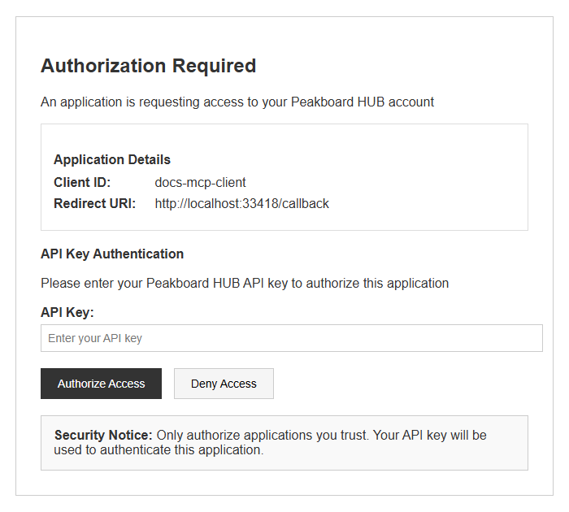

The **Peakboard Hub API** includes an **MCP server**. MCP (Model Context Protocol) is an open standard that lets AI clients such as Claude, ChatGPT or Visual Studio Code use external tools. Once connected, the AI client can, for example, read and edit your Peakboard Hub Lists, send alerts, take a screenshot of a Peakboard Box or start a Hub Flow — simply by being asked in a chat.

The MCP server is part of the [Peakboard Hub API](/hub/API/en-hub_api.html). It is available in Peakboard Hub Online and in Peakboard Hub On-Premises from version 2.2.5.0.

### Requirements

- A Peakboard Hub Online account or a Peakboard Hub On-Premises installation with the **Peakboard Hub Public API** installed (see [Peakboard Hub API](/hub/API/en-hub_api.html)).
- An **API key** of the user group whose data the AI client may access.
- An AI client that supports remote MCP servers over HTTP with OAuth authorization.

### Address of the MCP server

| Peakboard Hub | MCP server address |
|---|---|
| Peakboard Hub Online | `https://api.peakboard.com/mcp` |
| Peakboard Hub On-Premises | `http://<your-api-server>:20688/mcp` or, with HTTPS enabled, `https://<your-api-server>:20689/mcp` |

For Peakboard Hub On-Premises, use the host name of the server the API is installed on and the port you chose during the installation (default `20688` for HTTP, `20689` for HTTPS).

> **Note:** The AI client must be able to reach this address. Desktop clients (for example Claude Desktop or Visual Studio Code) running in your network can use the address of your local server. AI clients that run in the cloud (for example ChatGPT or Claude in the browser) can only connect to a Peakboard Hub On-Premises that is reachable from the internet via HTTPS.

> **Important for ChatGPT:** ChatGPT only connects to MCP servers via **HTTPS** on port **443**. An address with `http://` or with another port (for example `https://<your-api-server>:20689/mcp`) does not work. Peakboard Hub Online (`https://api.peakboard.com/mcp`) already meets this requirement. For Peakboard Hub On-Premises, make the API reachable from the internet via HTTPS on port 443 (for example with a reverse proxy, or by choosing port 443 as the HTTPS port of the API) and enter the address without a port: `https://<your-api-server>/mcp`.

### Step 1: Create an API key

The MCP server signs you in with an API key of the Peakboard Hub. The scopes of this key decide what the AI client is allowed to do.

- **Peakboard Hub Online:** Log in at [hub.peakboard.com](https://hub.peakboard.com) and navigate to *Organization → API KEYS*.
- **Peakboard Hub On-Premises:** Log into your local Hub and navigate to *Users → API KEYS*.

Click **Add**, select the **Scopes** the AI client should get, choose when the key **Expires in** and click **Create**. Copy the key with the clipboard icon.

> **Tip:** Only give the key the scopes the AI client really needs. A key with only `read:` scopes can look at data, but cannot change or delete anything.

### Step 2: Add the MCP server to your AI client

Add a new MCP server (sometimes called *connector* or *custom connector*) in your AI client and enter the address of the MCP server. Choose the transport **HTTP** (also called *Streamable HTTP*) if your client asks for it. You do not need to enter a client ID or a client secret: the AI client registers itself automatically.

Examples:

- **Claude Code:**
  ```
  claude mcp add --transport http peakboard-hub https://api.peakboard.com/mcp
  ```
- **Visual Studio Code** (`.vscode/mcp.json`):
  ```json
  {
    "servers": {
      "peakboard-hub": {
        "type": "http",
        "url": "https://api.peakboard.com/mcp"
      }
    }
  }
  ```

For Peakboard Hub On-Premises, replace the address with the address of your own API server.

In **ChatGPT**, enter an `https://` address on port 443 — see [Address of the MCP server](#address-of-the-mcp-server).

### Step 3: Authorize the AI client

When the AI client connects for the first time, it opens the page **Authorization Required** of the Peakboard Hub in your browser.



1. Check the **Client ID** and **Redirect URI** under **Application Details**.
2. Paste your API key into the **API Key** field.
3. Click **Authorize Access**.

The browser returns to the AI client, and the connection is ready. If the key is wrong, expired or deleted, the browser shows the error `Invalid or expired API key` instead. In this case, start the connection in the AI client again and enter a valid API key.

The AI client receives an access token that is valid for one hour and is renewed automatically, so you do not have to authorize again every hour.

> **Note:** Only authorize AI clients you trust. The AI client can do everything the scopes of the API key allow — for the whole user group of the key.

### Available tools

The AI client only sees the tools that the scopes of your API key allow. If it still calls a tool without the required scope, the Peakboard Hub answers with `Insufficient permissions. Missing required scopes: …`.

| Tool | What it does | Required scope |
|---|---|---|
| `get_lists` | Lists the Peakboard Hub Lists | `read:lists` |
| `get_list` | Reads the data of a Peakboard Hub List, with sorting and paging | `read:lists` |
| `get_list_by_sql` | Reads data of a Peakboard Hub List with an SQL query | `read:lists` |
| `add_list_record` | Adds a row to a Peakboard Hub List | `write:lists` |
| `update_list_record` | Changes a row of a Peakboard Hub List | `write:lists` |
| `delete_list_record` | Deletes a row of a Peakboard Hub List | `write:lists` |
| `get_alerts` | Reads the alerts | `read:alerts` |
| `send_alert` | Sends an alert | `write:alerts` |
| `get_boxes` | Lists the Peakboard Boxes | `read:box` |
| `get_box_screenshot` | Takes a screenshot of a Peakboard Box | `read:box` |
| `get_box_variables` | Reads the variables of a Peakboard Box | `read:box` |
| `get_box_lists` | Reads the lists of a Peakboard Box | `read:box` |
| `get_box_global_functions` | Lists the global functions of a Peakboard Box | `read:box` |
| `update_box_variable` | Changes a variable of a Peakboard Box | `write:box` |
| `add_box_list_record` | Adds a row to a list of a Peakboard Box | `write:box` |
| `update_box_list_record` | Changes a row of a list of a Peakboard Box | `write:box` |
| `delete_box_list_record` | Deletes a row of a list of a Peakboard Box | `write:box` |
| `run_box_global_functions` | Runs a global function on a Peakboard Box | `write:box` |
| `get_hubflow_projects` | Lists the Hub Flow projects and their Hub Flows | `read:hubflows` |
| `get_hubflow_list_data` | Reads the data of a Hub Flow output list | `read:hubflows` |
| `run_hubflow` | Starts a Hub Flow | `write:hubflows` |
| `list_files` | Lists the files and folders of a folder in the Peakboard Hub | `read:files` |
| `get_file` | Reads the details and versions of a file | `read:files` |
| `delete_file` | Deletes a file with all its versions | `write:files` |

### Example prompts

- *"Show me all lists in my Peakboard Hub."*
- *"Add a row with the order number 4711 and the status 'Open' to the list Orders."*
- *"Take a screenshot of the Peakboard Box in hall 2."*
- *"Send an alert: The conveyor belt in hall 2 is stopped."*
