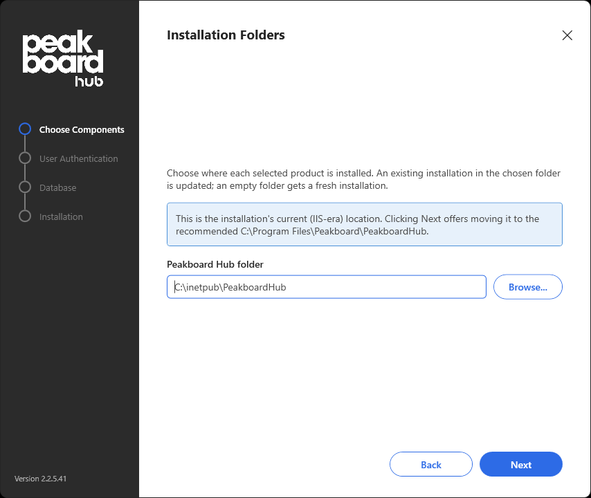
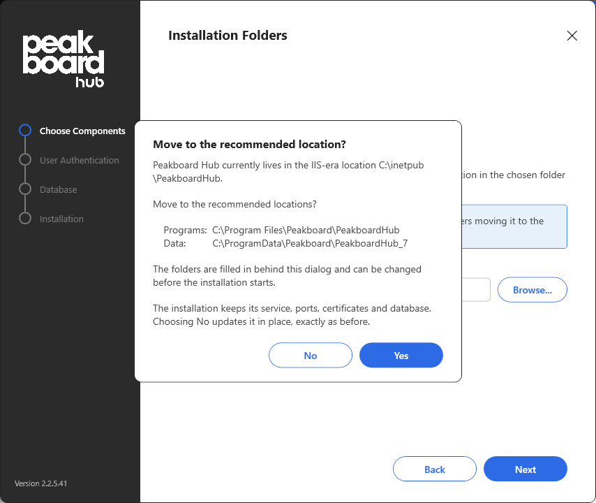
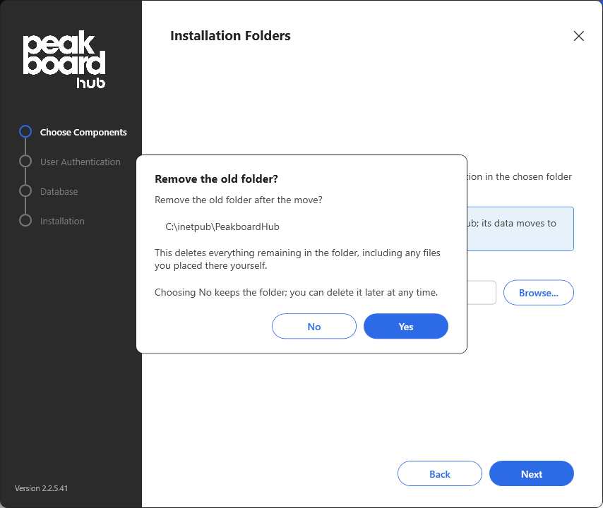
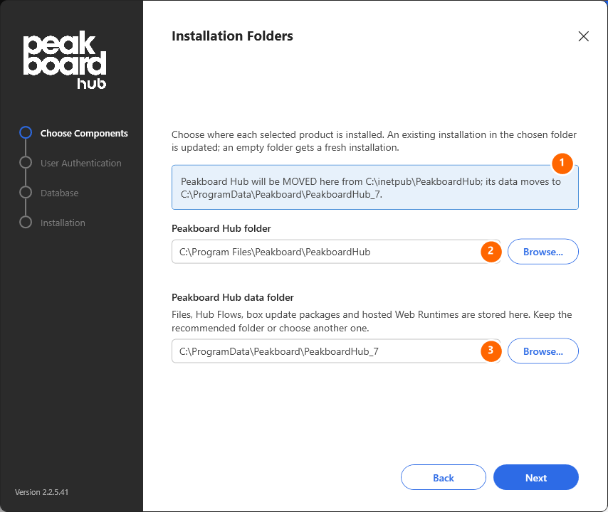
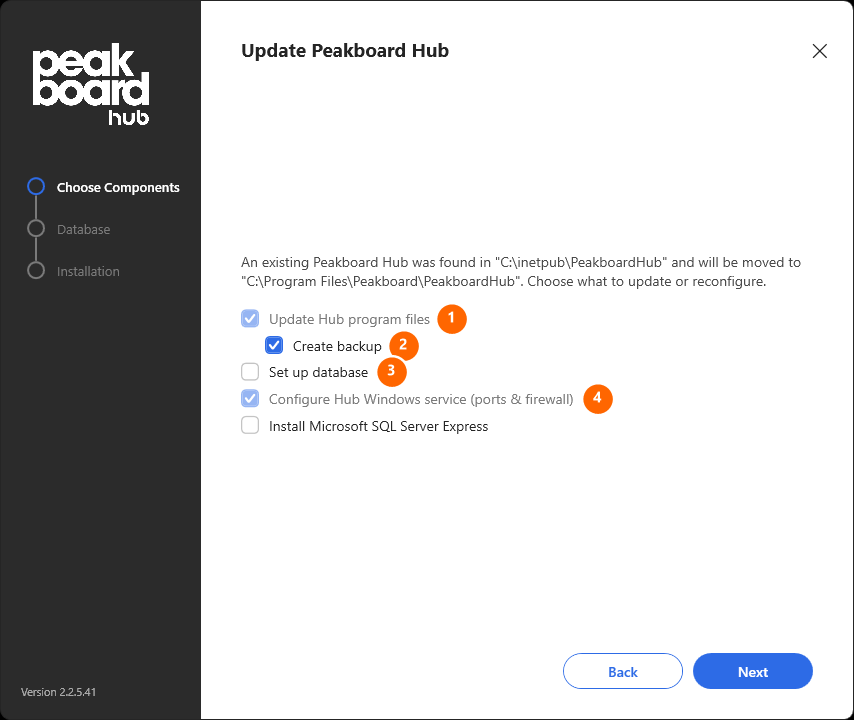
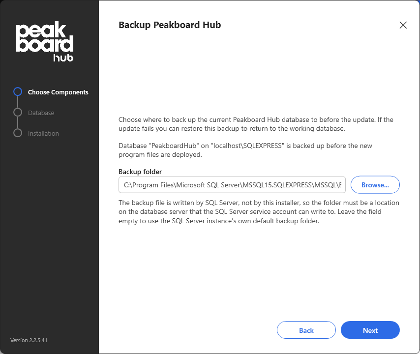
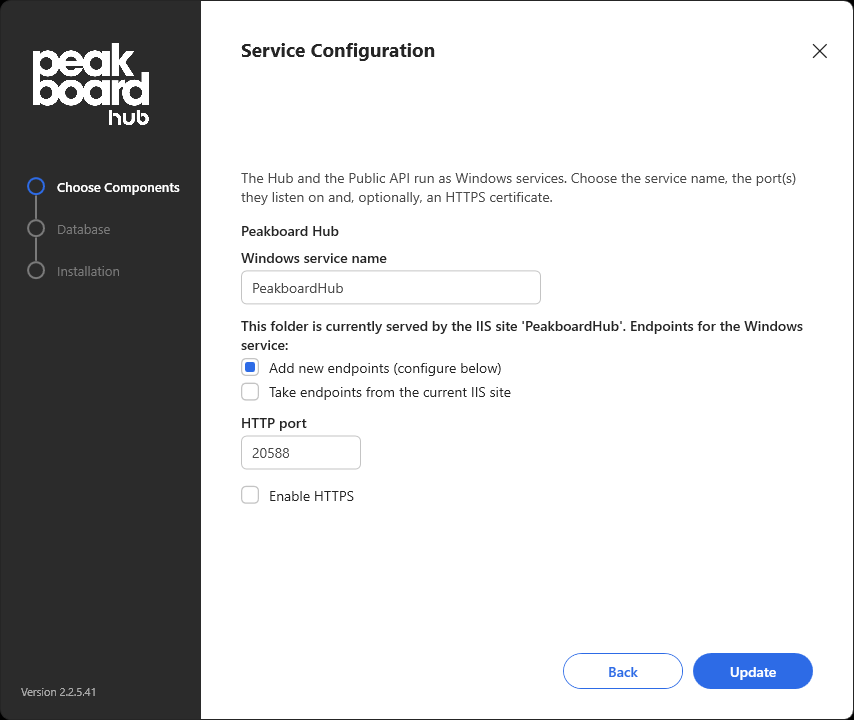
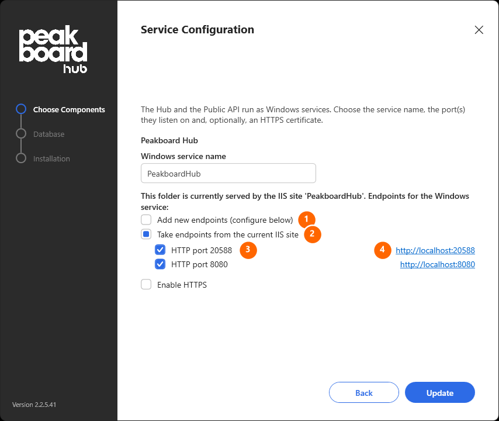

Frühere Versionen des Peakboard Hub on premise liefen als Seite im IIS (Internet Information Services). Das aktuelle Setup installiert den Peakboard Hub stattdessen als eigenen **Windows-Dienst**. Wenn du eine Installation aktualisierst, die noch im IIS läuft, migriert das Setup sie: Die IIS-Seite wird durch den Windows-Dienst ersetzt, Datenbank, Einstellungen und Daten bleiben erhalten.

Dieser Artikel erklärt, was sich ändert, wie du dich vorbereitest und wie du die Migration mit dem Setup-Assistenten oder über die Kommandozeile durchführst.

### Was sich ändert


{: .w-full }
| | Vorher (IIS) | Nachher (Windows-Dienst) |
|---|---|---|
| Hosting | IIS-Seite und Anwendungspool `PeakboardHub` | Windows-Dienst `PeakboardHub` (Anzeigename **Peakboard Hub**), läuft als Lokales System, startet automatisch (verzögert), startet nach einem Fehler neu |
| Programmordner | `C:\inetpub\PeakboardHub` | `C:\Program Files\Peakboard\PeakboardHub` (empfohlen — du kannst auch im alten Ordner bleiben) |
| Datenordner | Im Programmordner | `C:\ProgramData\Peakboard\PeakboardHub` |
| Ports und HTTPS-Zertifikat | Bindungen der IIS-Seite | Endpunkte in der `appsettings.json` im Programmordner |
| Ports oder Zertifikat ändern | IIS-Manager | Peakboard Hub Configurator (Windows-Startmenü) |
| Public API | IIS-Seite `PeakboardHubApi` | Windows-Dienst `PeakboardHubApi` |

IIS selbst wird nicht mehr benötigt. Das Setup deinstalliert das Windows-Feature IIS nicht — wenn keine andere Anwendung auf dem Server es nutzt, kannst du es anschließend entfernen.

### Bevor du beginnst

* **Plane ein Wartungsfenster ein.** Während das Setup läuft, ist der Peakboard Hub nicht erreichbar.
* **Notiere dir die Bindungen der IIS-Seite.** Öffne den IIS-Manager, wähle die Seite des Peakboard Hub aus und notiere dir ihre Ports und HTTPS-Zertifikate (**Bindungen**). Während der Migration entscheidest du, ob der Windows-Dienst sie übernimmt.
* **Prüfe dein HTTPS-Zertifikat.** Der Windows-Dienst kann nur Zertifikate aus dem Zertifikatspeicher **Eigene Zertifikate** des lokalen Computers nutzen. Eine Bindung, deren Zertifikat im **zentralen Zertifikatspeicher** des IIS liegt oder nicht mehr im Zertifikatspeicher vorhanden ist, kann nicht übernommen werden — der Peakboard Hub ist dann nur über HTTP erreichbar, bis du mit dem Peakboard Hub Configurator ein Zertifikat hinzufügst.
* **Prüfe auf gemeinsam genutzte Ports.** Teilt sich die Seite des Peakboard Hub einen Port mit einer anderen IIS-Seite (zum Beispiel Port 80 oder 443 neben der **Default Web Site**), bleibt dieser Port beim IIS. Der Windows-Dienst kann ihn nicht nutzen.
* **Sichere deine Datenbank.** Das Setup bietet vor dem Update eine Sicherung der Datenbank an (standardmäßig aktiviert). Eine eigene Sicherung schadet trotzdem nicht.
* **Sichere deine Dateien.** Das Setup sichert nur die Datenbank — die Dateien des Peakboard Hub gehören nicht dazu. Kopiere den Ordner deiner Installation, standardmäßig `C:\inetpub\PeakboardHub`, an einen sicheren Ort, zusammen mit allen Datenordnern, die du an einen anderen Ort umgeleitet hast. Er enthält unter anderem:
  * die nach [Files](/hub/de-hub_files.html) hochgeladenen Dateien (Ordner `HubFileStorage`)
  * die **Hub Flows** (Ordner `PeakboardHubFlows`)
  * die Update-Pakete für Boxen (Ordner `Update`) und die gehosteten Web Runtimes (Ordner `PeakboardHubWebRuntimes`)
  * die `appsettings.json` mit der Datenbankverbindung und allen weiteren Einstellungen

  Ohne diese Kopie kannst du nicht vollständig zur vorherigen Version zurückkehren, falls die Migration fehlschlägt, siehe [Zur vorherigen Version zurückkehren](#zur-vorherigen-version-zurückkehren).
* **Prüfe, ob Windows Single Sign-on genutzt wird.** Wähle im IIS-Manager die Seite des Peakboard Hub aus und öffne **Authentifizierung**. Ist **Windows-Authentifizierung** aktiviert, werden deine Benutzer mit ihrem Windows-Konto am Peakboard Hub angemeldet. Diese IIS-Einstellung wird **nicht** übernommen — du schaltest Single Sign-on nach der Migration wieder ein, siehe [Windows Single Sign-on](#windows-single-sign-on).
* Starte das Setup **mit Administratorrechten**.

### Migration mit dem Setup-Assistenten

Lade die aktuelle [Installationsdatei des Peakboard Hub on premise](https://downloads.peakboard.com/download/PeakboardHub/master/PeakboardHubSetup.exe) herunter und starte sie auf dem Server deiner bestehenden Installation. Wähle auf der ersten Seite **Peakboard Hub** (und **Peakboard Hub Public API**, falls sie auf diesem Server installiert ist) und klicke auf [Next].

#### Schritt 1 — Bestehende Installation auswählen

Wähle auf der Seite **Installation Folders** den Ordner deiner bestehenden Installation, standardmäßig `C:\inetpub\PeakboardHub`. Ist es der alte Standardordner, weist dich ein Hinweis darauf hin, dass dies der IIS-Speicherort der Installation ist und dass dir nach einem Klick auf [Next] das Verschieben angeboten wird.



<div class="box-warning" markdown="1"> **Wichtig**: Gib hier keinen neuen, leeren Ordner ein, um die Installation zu „verschieben“. Ein anderer Ordner legt einen zweiten, unabhängigen Peakboard Hub neben dem bestehenden an, und die bestehende Installation bleibt unverändert. Wähle den bestehenden Ordner und lass das Setup die Installation verschieben, wie unten beschrieben.
</div>

#### Schritt 2 — An den empfohlenen Speicherort verschieben

Wenn du auf [Next] klickst, fragt das Setup **Move to the recommended location?**:

* [Yes] — Die Programme werden nach `C:\Program Files\Peakboard\PeakboardHub` verschoben und die Daten (hochgeladene Dateien, Hub Flows, Update-Pakete für Boxen, gehostete Web Runtimes) in einen Datenordner unter `C:\ProgramData\Peakboard`. Die Ordner werden auf der Seite hinter dem Dialog eingetragen und können noch geändert werden.
* [No] — Der Peakboard Hub bleibt in `C:\inetpub\PeakboardHub`. Er wird trotzdem in einen Windows-Dienst umgewandelt.

In beiden Fällen behält die Installation ihren Dienstnamen, ihre Ports, ihre Zertifikate und ihre Datenbank.



Der Datenordner ist normalerweise `C:\ProgramData\Peakboard\PeakboardHub`. Wird dieser Ordner bereits von einer anderen Installation genutzt, hängt das Setup eine Nummer an, zum Beispiel `PeakboardHub_2` (der Screenshot stammt von einem Testserver mit mehreren Installationen).

<div class="box-tip" markdown="1"> **Hinweis**: Das Verschieben wird nur für den alten Standardordner `C:\inetpub\PeakboardHub` angeboten. Eine Installation in einem eigenen Ordner wird in diesem Ordner aktualisiert. Über die Kommandozeile kannst du jede Installation aus der IIS-Zeit verschieben, siehe [Migration über die Kommandozeile](#migration-über-die-kommandozeile), oder von Hand verschieben, siehe [Installation manuell verschieben](#installation-manuell-verschieben). Der neue Ordner muss auf demselben Laufwerk liegen wie `C:\ProgramData`.
</div>

Hast du [Yes] gewählt, fragt das Setup anschließend **Remove the old folder?**:

* [Yes] — Nach dem Verschieben wird der alte Ordner gelöscht, einschließlich aller Dateien, die du selbst dort abgelegt hast.
* [No] — Der alte Ordner bleibt erhalten. Du kannst ihn später jederzeit löschen. Das Setup sorgt dafür, dass der behaltene Ordner nicht mehr für eine Installation gehalten werden kann.



Die Seite **Installation Folders** zeigt jetzt, wohin der Peakboard Hub verschoben wird (1), den neuen Programmordner (2) und den neuen Datenordner (3). Datenordner, die du früher an einen anderen Ort umgeleitet hast, werden nicht verschoben. Klicke auf [Next].



#### Schritt 3 — Komponenten

Die Seite **Update Peakboard Hub** nennt den alten und den neuen Ordner:

* **Update Hub program files** (1) — Gehört bei einer Migration immer dazu.
* **Create backup** (2) — Sichert die Datenbank, bevor die neuen Programmdateien kopiert werden. Lass die Option aktiviert.
* **Set up database** (3) — Lass die Option abgewählt. Der Peakboard Hub behält seine aktuelle Datenbankverbindung.
* **Configure Hub Windows service (ports & firewall)** (4) — Bei einer Installation, die noch im IIS läuft, immer aktiviert, weil die IIS-Seite durch den Windows-Dienst ersetzt wird.

Klicke auf [Next].



#### Schritt 4 — Sicherungsordner

Auf der Seite **Backup Peakboard Hub** wählst du, wohin die Sicherung der Datenbank geschrieben wird. Die Sicherungsdatei schreibt der SQL Server, deshalb muss der Ordner auf dem Datenbankserver liegen und für das Dienstkonto des SQL Servers beschreibbar sein. Lässt du das Feld leer, wird der Standard-Sicherungsordner der SQL-Server-Instanz genutzt. Klicke auf [Next].



#### Schritt 5 — Endpunkte des Windows-Dienstes

Auf der Seite **Service Configuration** zeigt das Setup, welche IIS-Seite den Ordner aktuell bereitstellt, und fragt, woher die Endpunkte des Windows-Dienstes kommen:

* **Add new endpoints (configure below)** (1) — Vorausgewählt. Aus dem IIS wird nichts automatisch übernommen; der Windows-Dienst bekommt nur den **HTTP port** und die optionalen HTTPS-Einstellungen, die du darunter einträgst.



* **Take endpoints from the current IIS site** (2) — Listet alle Bindungen der IIS-Seite auf (3). Wähle die aus, die der Windows-Dienst übernehmen soll. Jede Bindung hat einen Link (4), der sie im Browser öffnet, damit du prüfen kannst, was dort erreichbar ist. Bindungen, die nicht übernommen werden können, werden deaktiviert mit dem Grund angezeigt — zum Beispiel ein Port, den eine andere IIS-Seite nutzt, oder ein Zertifikat, das im Zertifikatspeicher nicht gefunden wird.



Die erste ausgewählte HTTP-Bindung wird zum Hauptport des Windows-Dienstes, jede weitere Auswahl zu einem zusätzlichen Endpunkt. Es können höchstens 5 HTTP- und 4 HTTPS-Endpunkte übernommen werden. Eine HTTPS-Bindung behält ihr Zertifikat.

<div class="box-warning" markdown="1"> **Bitte beachten**: Die IIS-Seite und ihr Anwendungspool werden in beiden Fällen gelöscht. Wählst du **Add new endpoints** mit einem anderen Port als dem der IIS-Seite, ist der Peakboard Hub danach nur noch auf dem neuen Port erreichbar — passe alle Clients an, die sich mit ihm verbinden, zum Beispiel Peakboard Boxen.
</div>

#### Schritt 6 — Update ausführen

Der Button der letzten Seite heißt [Update]. Klicke darauf, um die Migration zu starten. Das Setup stoppt die IIS-Seite, kopiert die neuen Programmdateien, verschiebt die Ordner (falls gewählt), legt den Windows-Dienst an und startet ihn, übernimmt die ausgewählten Endpunkte, öffnet die Ports in der Windows-Firewall und löscht zum Schluss die IIS-Seite und ihren Anwendungspool.

Nach Abschluss der Migration zeigt die Seite **Installation finished**, was installiert wurde und — nach einem Verschieben — was wohin verschoben wurde, zusammen mit einer Erinnerung, was du selbst anpassen musst.

### Was das Setup übernimmt

* Die Datenbankverbindung, die Art der Authentifizierung und alle weiteren Einstellungen in der `appsettings.json`.
* Die Identität des Dienstes, die Ports und die ausgewählten HTTPS-Zertifikate.
* Alle Datenordner. Das Setup passt auch die zugehörigen Einstellungen in der Datenbank an.
* Einen Eintrag unter Windows **Apps & Features**.

Nicht übernommen wird **Windows Single Sign-on**. Im IIS war es eine Einstellung der IIS-Seite, die bei der Migration gelöscht wird. Nach der Migration ist es ausgeschaltet, siehe [Windows Single Sign-on](#windows-single-sign-on).

### Nach der Migration

Was außerhalb der Installation liegt, kann das Setup nicht erreichen. Passe nach einem Verschieben alles an, was auf den alten Ordner `C:\inetpub\PeakboardHub` verweist:

* Sicherungsjobs und ihre Ziel- und Ausschlusspfade
* Ausnahmen in Virenschutz oder EDR
* Netzwerkfreigaben und eigene Ordnerberechtigungen
* Eigene Skripte, geplante Aufgaben und Überwachungen

Um die Ports oder das HTTPS-Zertifikat später zu ändern, nutzt du den **Peakboard Hub Configurator** aus dem Windows-Startmenü, siehe [Installation](/hub/Peakboard_Hub_on_premise/de-hub_installation.html#konfiguration-später-ändern).

<div class="box-tip" markdown="1"> **Hinweis**: Funktioniert der Peakboard Hub nach einem Update im Browser nicht richtig — bleiben zum Beispiel Seiten leer, reagieren Buttons nicht oder wird noch die alte Version angezeigt —, verwendet der Browser vermutlich noch Dateien der vorherigen Version aus seinem Cache. Lade die Seite ohne Cache neu: Drücke [Strg + F5] (macOS: [Cmd + Shift + R]). Hilft das nicht, lösche im Browser die gespeicherten Daten der Adresse des Peakboard Hub: Öffne über das Symbol links neben der Adressleiste die Website-Einstellungen, lösche die Websitedaten (Cookies und gespeicherte Daten) und lade die Seite neu. Dabei wirst du abgemeldet und musst dich anschließend neu anmelden.
</div>

#### Windows Single Sign-on

Wurden deine Benutzer vor der Migration automatisch mit ihrem Windows-Konto angemeldet (**Windows-Authentifizierung** der IIS-Seite), schalte Single Sign-on im Peakboard Hub Configurator wieder ein:

1. Öffne den **Peakboard Hub Configurator** aus dem Windows-Startmenü.
2. Wechsle zu **Authentication**.
3. Aktiviere unter **Windows single sign-on** die Option **Enable Windows SSO (Negotiate)**.
4. Klicke auf [Apply changes] und bestätige den Dialog **Apply configuration changes** mit [Apply and restart]. Der Peakboard Hub Configurator startet den Peakboard Hub neu.

Single Sign-on funktioniert nicht über HTTP/2 und nicht hinter einem Reverse Proxy. Für den HTTPS-Endpunkt musst du nichts tun — das Setup legt ihn auf HTTP/1.1 fest. Die Anmeldequelle (**Local Users** oder **AD Users**) wird aus der `appsettings.json` übernommen und bleibt, wie sie war.

<div class="box-tip" markdown="1"> **Hinweis**: Ein Browser, der den Peakboard Hub auf einem Port geöffnet hat, den der Windows-Dienst nicht mehr nutzt, kann die Anmeldeseite weiterhin aus seinem Cache anzeigen, obwohl auf diesem Port nichts mehr antwortet (zum Beispiel mit der Meldung „Gateway Timeout“ nach der Anmeldung). Lösche im Browser die Websitedaten dieser Adresse.
</div>

### Migration über die Kommandozeile

Die Migration lässt sich auch unbeaufsichtigt ausführen. Alle Argumente beschreibt der Artikel [Silent-Installation](/hub/Peakboard_Hub_on_premise/de-hub_silent-installation.html).

Update am bisherigen Ort — der Peakboard Hub bleibt in seinem Ordner und wird zum Windows-Dienst:

```bat
PeakboardHubSetup.exe -Silent True -InstallPath "C:\inetpub\PeakboardHub"
```

Die Installation in die empfohlenen Ordner verschieben und die alten Ordner anschließend löschen:

```bat
PeakboardHubSetup.exe -Silent True ^
  -InstallPath "C:\Program Files\Peakboard\PeakboardHub" ^
  -ApiInstallPath "C:\Program Files\Peakboard\PeakboardHubApi" ^
  -HubMigrateFrom "C:\inetpub\PeakboardHub" ^
  -ApiMigrateFrom "C:\inetpub\PeakboardHubApi" ^
  -RemoveOldFolders True
```

<div class="box-warning" markdown="1"> **Wichtig**: Kommandozeile und Assistent gehen unterschiedlich mit den IIS-Bindungen um. Über die Kommandozeile werden standardmäßig **alle** wiederverwendbaren Bindungen der IIS-Seite übernommen. Mit `-HubEndpointsFromIis False` (Public API: `-ApiEndpointsFromIis False`) wird nichts aus dem IIS übernommen, und es gelten nur die Ports aus der Kommandozeile.
</div>

### Installation manuell verschieben

Verschiebe die Installation nur dann von Hand, wenn das Setup das Verschieben nicht anbietet — zum Beispiel, wenn es die Installation nicht als Installation aus der IIS-Zeit erkennt, oder wenn der Peakboard Hub bereits als Windows-Dienst in seinem alten Ordner läuft.

Die Schritte verwenden die folgenden Ordner. Ersetze sie durch deine eigenen Ordner, wo sie abweichen.

| Ordner | Pfad |
|---|---|
| Alter Ordner | `C:\inetpub\PeakboardHub` |
| Neuer Programmordner | `C:\Program Files\Peakboard\PeakboardHub` |
| Neuer Datenordner | `C:\ProgramData\Peakboard\PeakboardHub` |

Lege zuerst die unter [Bevor du beginnst](#bevor-du-beginnst) beschriebenen Sicherungen an und führe alle Schritte mit Administratorrechten aus.

#### Teil 1 — Im alten Ordner aktualisieren

Überspringe diesen Teil, wenn der Peakboard Hub bereits in der aktuellen Version als Windows-Dienst läuft.

1. Starte das aktuelle Setup und wähle auf der Seite **Installation Folders** den bestehenden Ordner. Das Setup wandelt den Peakboard Hub in diesem Ordner in einen Windows-Dienst um.
2. Prüfe, ob das Update funktioniert hat: Die Seite **Installation finished** zeigt keine Fehler, der Dienst **Peakboard Hub** läuft (`services.msc`), und du kannst dich anmelden und siehst deine Boxen, Dateien und Hub Flows.

Fahre erst fort, wenn alles funktioniert.

#### Teil 2 — Datenordner verschieben

1. Öffne den Peakboard Hub im Browser und wechsle zu **Settings**.
2. Setze im Bereich **Files** den **Folder for storing files** auf `C:\ProgramData\Peakboard\PeakboardHub\HubFileStorage\`.
3. Setze im Bereich **Hub Flows** den **Folder for storing active Hub Flow Applications** auf `C:\ProgramData\Peakboard\PeakboardHub\PeakboardHubFlows`.
4. Speichere. Der Peakboard Hub verschiebt den vorhandenen Inhalt selbst in die neuen Ordner. Laufende Hub Flows werden für das Verschieben angehalten und danach wieder gestartet.
5. Warte, bis die alten Ordner leer oder gelöscht sind.

#### Teil 3 — Programmordner verschieben

1. Stoppe den Dienst: `sc.exe stop PeakboardHub`
2. Verschiebe den kompletten Ordner `C:\inetpub\PeakboardHub` einschließlich der `appsettings.json` nach `C:\Program Files\Peakboard\PeakboardHub`.
3. Lösche den Dienst, denn er verweist noch auf den alten Ordner: `sc.exe delete PeakboardHub`

Hast du dem Dienst bei der Installation einen anderen Namen gegeben, verwende diesen statt `PeakboardHub`. Du findest ihn in den Eigenschaften des Dienstes unter **Dienstname**.

#### Teil 4 — Dienst im neuen Ordner anlegen

1. Starte das Setup und wähle **Peakboard Hub**.
2. Gib auf der Seite **Installation Folders** den neuen Ordner `C:\Program Files\Peakboard\PeakboardHub` ein.
3. Wähle auf der Seite **Update Peakboard Hub** die Option **Update Hub program files** ab (die Dateien sind bereits aktuell) und lass **Set up database** abgewählt. **Configure Hub Windows service (ports & firewall)** bleibt ausgewählt.
4. Lege auf der Seite **Service Configuration** die Ports, die HTTP-Einstellungen und den bisherigen Dienstnamen fest.
5. Klicke auf **Update**. Das Setup legt den Windows-Dienst an und startet ihn, öffnet die Ports in der Windows-Firewall und trägt die Installation unter Windows **Apps & Features** ein.

#### Teil 5 — Alte Registry-Einträge entfernen

Die Registry-Einträge des alten Ordners bleiben erhalten. Sie erscheinen als zweiter Peakboard Hub unter **Apps & Features** und im Peakboard Hub Configurator, und ihr Uninstaller würde auf den alten Ordner zugreifen. Öffne den Registrierungs-Editor (`regedit`) und exportiere jeden Schlüssel, bevor du ihn löschst.

1. Suche unter `HKEY_LOCAL_MACHINE\SOFTWARE\Peakboard\Hub` den Unterschlüssel, dessen Wert `InstallPath` der alte Ordner ist. Notiere dir seinen Namen (die Installations-ID) und lösche den Unterschlüssel. Lösche **nicht** den Unterschlüssel des neuen Ordners.
2. Lösche `HKEY_LOCAL_MACHINE\SOFTWARE\Microsoft\Windows\CurrentVersion\Uninstall\<Installations-ID>`.
3. Existieren die Schlüssel älterer Setup-Versionen noch und verweisen auf den alten Ordner, lösche sie ebenfalls: `HKEY_LOCAL_MACHINE\SOFTWARE\Peakboard Hub` und `HKEY_LOCAL_MACHINE\SOFTWARE\Microsoft\Windows\CurrentVersion\Uninstall\Peakboard Hub`.

#### Teil 6 — Ergebnis prüfen

Melde dich am Peakboard Hub an und prüfe deine Boxen, Dateien und Hub Flows. Passe anschließend alles an, was auf den alten Ordner verweist, siehe [Nach der Migration](#nach-der-migration). Den alten Ordner kannst du löschen, sobald er leer ist.

#### Public API verschieben

Die Public API verschiebst du mit den Teilen 3 bis 5. Sie hat keine eigenen Datenordner. Verwende diese Werte:

| | Peakboard Hub | Public API |
|---|---|---|
| Dienst | `PeakboardHub` | `PeakboardHubApi` |
| Alter Ordner | `C:\inetpub\PeakboardHub` | `C:\inetpub\PeakboardHubApi` |
| Neuer Ordner | `C:\Program Files\Peakboard\PeakboardHub` | `C:\Program Files\Peakboard\PeakboardHubApi` |
| Komponenten | **Update Hub program files**, **Configure Hub Windows service (ports & firewall)** | **Update API program files**, **Configure API Windows service (ports & firewall)** |
| Registry | `HKEY_LOCAL_MACHINE\SOFTWARE\Peakboard\Hub` (ältere Setup-Versionen: `Peakboard Hub`) | `HKEY_LOCAL_MACHINE\SOFTWARE\Peakboard\Api` (ältere Setup-Versionen: `Peakboard Hub API`) |

### Zur vorherigen Version zurückkehren

Führe **kein** älteres Setup aus, um eine Migration rückgängig zu machen. Es erkennt die migrierte Installation nicht und würde eine zweite IIS-Seite auf denselben Ports anlegen. So kehrst du zurück:

1. Deinstalliere den migrierten Peakboard Hub mit seinem [Uninstaller](/hub/Peakboard_Hub_on_premise/de-hub_uninstallation.html) (Daten behalten).
2. Installiere die vorherige Version.
3. Stelle die Datenbanksicherung von vor dem Update wieder her.
4. Stelle die Dateisicherung von vor dem Update (hochgeladene Dateien, Hub Flows, `appsettings.json` und die übrigen Datenordner) im Ordner der vorherigen Installation wieder her.

### Fehlerbehebung


{: .w-full }
| Problem | Ursache und Lösung |
|---|---|
| Der Peakboard Hub ist nach der Migration nur über HTTP erreichbar | Das Zertifikat der HTTPS-Bindung lag im zentralen Zertifikatspeicher des IIS oder war nicht mehr im Zertifikatspeicher vorhanden. Das Setup-Protokoll nennt die Bindung. Lege das Zertifikat im Speicher **Eigene Zertifikate** des lokalen Computers ab und wähle es im Peakboard Hub Configurator aus. |
| Benutzer werden nicht mehr automatisch mit ihrem Windows-Konto angemeldet | Windows Single Sign-on war eine Einstellung der IIS-Seite und wird nicht übernommen. Aktiviere es im Peakboard Hub Configurator, siehe [Windows Single Sign-on](#windows-single-sign-on). |
| Ein Port der IIS-Seite wurde nicht übernommen | Eine andere IIS-Seite nutzt denselben Port. Das Setup-Protokoll nennt diese Seite. Nutze für den Peakboard Hub einen anderen Port. |
| Das Setup meldet unvollständige Programmdateien und einen deaktivierten Dienst | Das Update ist beim Kopieren der Dateien fehlgeschlagen. Starte dasselbe Setup noch einmal, um es abzuschließen. |

Die Protokolldateien des Setups liegen unter `C:\ProgramData\Peakboard\LocalState\Logs\Setup\`.
