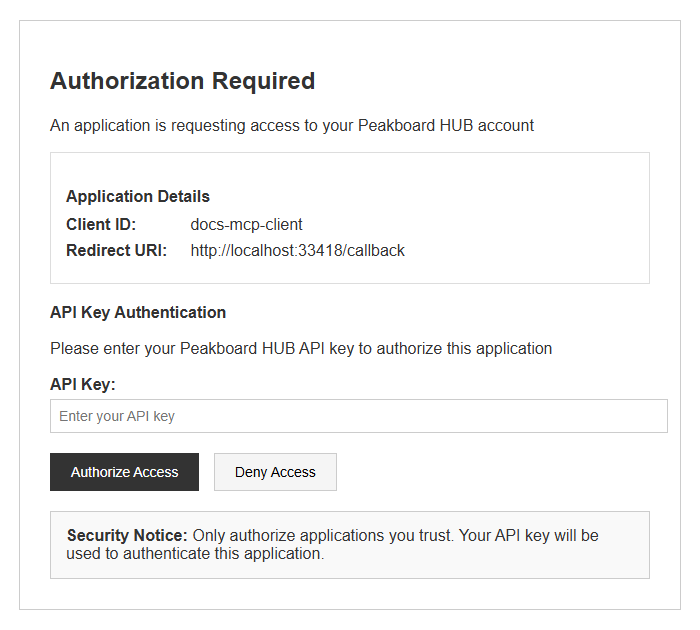

Die **Peakboard Hub API** enthält einen **MCP Server**. MCP (Model Context Protocol) ist ein offener Standard, über den KI-Clients wie Claude, ChatGPT oder Visual Studio Code externe Werkzeuge nutzen können. Nach dem Verbinden kann der KI-Client zum Beispiel Ihre Peakboard Hub Listen lesen und bearbeiten, Alerts senden, einen Screenshot einer Peakboard Box aufnehmen oder einen Hub Flow starten – einfach, indem Sie ihn im Chat darum bitten.

Der MCP Server ist Teil der [Peakboard Hub API](/hub/de-hub_api.html). Er steht im Peakboard Hub Online und im Peakboard Hub On-Premises ab Version 2.2.5.0 zur Verfügung.

### Voraussetzungen

- Ein Konto im Peakboard Hub Online oder eine Installation des Peakboard Hub On-Premises mit installierter **Peakboard Hub Public API** (siehe [Peakboard Hub API](/hub/de-hub_api.html)).
- Ein **API-Schlüssel** der Benutzergruppe, auf deren Daten der KI-Client zugreifen darf.
- Ein KI-Client, der entfernte MCP Server über HTTP mit OAuth-Autorisierung unterstützt.

### Adresse des MCP Servers

| Peakboard Hub | Adresse des MCP Servers |
|---|---|
| Peakboard Hub Online | `https://api.peakboard.com/mcp` |
| Peakboard Hub On-Premises | `http://<ihr-api-server>:20688/mcp` oder, mit aktiviertem HTTPS, `https://<ihr-api-server>:20689/mcp` |

Für den Peakboard Hub On-Premises verwenden Sie den Hostnamen des Servers, auf dem die API installiert ist, und den Port, den Sie bei der Installation gewählt haben (Standard `20688` für HTTP, `20689` für HTTPS).

> **Hinweis:** Der KI-Client muss diese Adresse erreichen können. Desktop-Clients in Ihrem Netzwerk (zum Beispiel Claude Desktop oder Visual Studio Code) können die Adresse Ihres lokalen Servers verwenden. KI-Clients, die in der Cloud laufen (zum Beispiel ChatGPT oder Claude im Browser), können sich nur mit einem Peakboard Hub On-Premises verbinden, der aus dem Internet über HTTPS erreichbar ist.

### Schritt 1: API-Schlüssel erstellen

Der MCP Server meldet Sie mit einem API-Schlüssel des Peakboard Hub an. Die Scopes dieses Schlüssels legen fest, was der KI-Client tun darf.

- **Peakboard Hub Online:** Melden Sie sich unter [hub.peakboard.com](https://hub.peakboard.com) an und navigieren Sie zu *Organization → API KEYS*.
- **Peakboard Hub On-Premises:** Melden Sie sich an Ihrem lokalen Hub an und navigieren Sie zu *Users → API KEYS*.

Klicken Sie auf **Add**, wählen Sie unter **Scopes** die Berechtigungen, die der KI-Client erhalten soll, legen Sie unter **Expires in** die Gültigkeit fest und klicken Sie auf **Create**. Kopieren Sie den Schlüssel über das Zwischenablage-Symbol.

> **Tipp:** Geben Sie dem Schlüssel nur die Scopes, die der KI-Client wirklich braucht. Ein Schlüssel mit ausschließlich `read:`-Scopes kann Daten ansehen, aber nichts ändern oder löschen.

### Schritt 2: MCP Server im KI-Client hinzufügen

Fügen Sie in Ihrem KI-Client einen neuen MCP Server hinzu (manchmal *Connector* oder *Custom Connector* genannt) und tragen Sie die Adresse des MCP Servers ein. Wählen Sie als Transport **HTTP** (auch *Streamable HTTP*), falls Ihr Client danach fragt. Eine Client-ID oder ein Client-Secret müssen Sie nicht eingeben: Der KI-Client registriert sich automatisch.

Beispiele:

- **Claude Code:**
  ```
  claude mcp add --transport http peakboard-hub https://api.peakboard.com/mcp
  ```
- **Visual Studio Code** (`.vscode/mcp.json`):
  ```json
  {
    "servers": {
      "peakboard-hub": {
        "type": "http",
        "url": "https://api.peakboard.com/mcp"
      }
    }
  }
  ```

Für den Peakboard Hub On-Premises ersetzen Sie die Adresse durch die Adresse Ihres eigenen API-Servers.

### Schritt 3: KI-Client autorisieren

Wenn sich der KI-Client zum ersten Mal verbindet, öffnet er in Ihrem Browser die Seite **Authorization Required** des Peakboard Hub.



1. Prüfen Sie unter **Application Details** die **Client ID** und die **Redirect URI**.
2. Fügen Sie Ihren API-Schlüssel in das Feld **API Key** ein.
3. Klicken Sie auf **Authorize Access**.

Der Browser kehrt zum KI-Client zurück, und die Verbindung ist eingerichtet. Ist der Schlüssel falsch, abgelaufen oder gelöscht, zeigt der Browser stattdessen den Fehler `Invalid or expired API key`. Starten Sie in diesem Fall die Verbindung im KI-Client erneut und geben Sie einen gültigen API-Schlüssel ein.

Der KI-Client erhält ein Zugriffstoken, das eine Stunde gültig ist und automatisch erneuert wird. Sie müssen also nicht jede Stunde neu autorisieren.

> **Hinweis:** Autorisieren Sie nur KI-Clients, denen Sie vertrauen. Der KI-Client kann alles tun, was die Scopes des API-Schlüssels erlauben – für die gesamte Benutzergruppe des Schlüssels.

### Verfügbare Werkzeuge

Der KI-Client sieht nur die Werkzeuge, die die Scopes Ihres API-Schlüssels erlauben. Ruft er trotzdem ein Werkzeug ohne den nötigen Scope auf, antwortet der Peakboard Hub mit `Insufficient permissions. Missing required scopes: …`.

| Werkzeug | Funktion | Benötigter Scope |
|---|---|---|
| `get_lists` | Listet die Peakboard Hub Listen auf | `read:lists` |
| `get_list` | Liest die Daten einer Peakboard Hub Liste, mit Sortierung und Seitenaufteilung | `read:lists` |
| `get_list_by_sql` | Liest Daten einer Peakboard Hub Liste über eine SQL-Abfrage | `read:lists` |
| `add_list_record` | Fügt einer Peakboard Hub Liste eine Zeile hinzu | `write:lists` |
| `update_list_record` | Ändert eine Zeile einer Peakboard Hub Liste | `write:lists` |
| `delete_list_record` | Löscht eine Zeile einer Peakboard Hub Liste | `write:lists` |
| `get_alerts` | Liest die Alerts | `read:alerts` |
| `send_alert` | Sendet einen Alert | `write:alerts` |
| `get_boxes` | Listet die Peakboard Boxen auf | `read:box` |
| `get_box_screenshot` | Nimmt einen Screenshot einer Peakboard Box auf | `read:box` |
| `get_box_variables` | Liest die Variablen einer Peakboard Box | `read:box` |
| `get_box_lists` | Liest die Listen einer Peakboard Box | `read:box` |
| `get_box_global_functions` | Listet die globalen Funktionen einer Peakboard Box auf | `read:box` |
| `update_box_variable` | Ändert eine Variable einer Peakboard Box | `write:box` |
| `add_box_list_record` | Fügt einer Liste einer Peakboard Box eine Zeile hinzu | `write:box` |
| `update_box_list_record` | Ändert eine Zeile einer Liste einer Peakboard Box | `write:box` |
| `delete_box_list_record` | Löscht eine Zeile einer Liste einer Peakboard Box | `write:box` |
| `run_box_global_functions` | Führt eine globale Funktion auf einer Peakboard Box aus | `write:box` |
| `get_hubflow_projects` | Listet die Hub Flow Projekte und ihre Hub Flows auf | `read:hubflows` |
| `get_hubflow_list_data` | Liest die Daten einer Ausgabeliste eines Hub Flows | `read:hubflows` |
| `run_hubflow` | Startet einen Hub Flow | `write:hubflows` |
| `list_files` | Listet die Dateien und Ordner eines Ordners im Peakboard Hub auf | `read:files` |
| `get_file` | Liest die Details und Versionen einer Datei | `read:files` |
| `delete_file` | Löscht eine Datei mit allen Versionen | `write:files` |

### Beispiel-Prompts

- *„Zeige mir alle Listen in meinem Peakboard Hub."*
- *„Füge der Liste Orders eine Zeile mit der Auftragsnummer 4711 und dem Status 'Offen' hinzu."*
- *„Mach einen Screenshot der Peakboard Box in Halle 2."*
- *„Sende einen Alert: Das Förderband in Halle 2 steht."*
